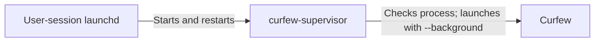

# Background enforcement

Maintainers should use this document to verify that window visibility never controls enforcement and to test process recovery before a release.

Curfew keeps its existing schedule engine in the app process. A user-session supervisor restores that process after termination. This avoids moving extensions, overrides, account releases, and overlays into a second enforcement implementation.

## Component diagram

The diagram shows the three process components involved in recovery.

The supervisor checks the Curfew process every five seconds and reacts to workspace termination notifications. It launches the app without activating it or restoring ordinary windows. Curfew creates lockout overlays when its schedule requires them. Closing every ordinary window leaves the timer running.

The root daemon remains optional. The supervisor runs as the signed-in user and adds no privileged capability. Users can still disable background services through macOS. This version addresses Quit, Force Quit, crashes, and login recovery; it does not claim resistance to deliberate repeated process killing or service removal.

## Registration and recovery

Completed onboarding enables background registration. Existing users register on their first upgraded launch. An approval requirement or registration failure remains visible in enforcement settings. Curfew removes the legacy lockout-only agent only after macOS reports the supervisor enabled.

Production and development use separate service identities. Ordinary Debug builds, demo captures, and unit hosts never register a service. Explicit signed staging validation requires the bundle Boolean `CurfewAcceptanceFixture`, the current development identity, and isolated fixture state. `CURFEW_STAGING` alone selects staging endpoints and cannot enable supervisor registration. Development registers `studio.hypertext.apps.curfew.dev.supervisor`; production registers `studio.hypertext.apps.curfew.supervisor`. The helper lives in `CurfewKit/Sources/curfew-supervisor/`.

The supervisor resolves its executable through dyld because launchd can supply relative service arguments. The helper bundle phase runs SwiftPM on every Xcode build. SwiftPM tracks source dependencies and rebuilds changed helpers before Xcode copies and signs them.

Runtime grant state is stored separately from telemetry. Curfew saves it atomically before applying a grant and restores it before its first evaluation. Restarting cannot refill weekly budgets or remove an unexpired local override. Existing signed remote releases and durable deadlines retain their existing authority.

The first upgrade reconstructs extension and override usage from existing local history. Older versions did not record snooze grants, so Curfew cannot recover that historical daily value. Grants issued by this version survive subsequent restarts.

App, shell, and Homebrew uninstall paths unregister recovery before removing state. A failed unregister aborts removal. Successful app uninstall stops the timer, wake observers, keyboard shield, and enforcement ownership before deletion. Homebrew also unregisters during upgrade/reinstall; successful explicit unregister clears the registration-attempt marker so the replacement build can register on launch.

## Release evidence

The acceptance run must show no ordinary window before lockout, an overlay after the scheduled transition, recovery after both Quit and Force Quit, and cleanup with no later restart. A signed staging run must verify the embedded helper signature and real SMAppService status. Login recovery requires a real logout/login acceptance run; a mocked process list does not prove it.

The background fixture retains the current demo-session isolation while allowing its real timer to advance. The root daemon must not issue shutdown during staging acceptance. Use the Debug fixture with its isolated stores and disabled destructive effects. Record evidence and any remaining gates in the release runbook.

Only the background acceptance scenario in Debug compiled with `CURFEW_STAGING` honors the bundle's `CurfewAcceptanceKeyboardShield` Boolean. This explicit opt-in lets the isolated fixture install the real keyboard shield after Accessibility approval. Ordinary captures and test hosts cannot intercept keys. The fixture still blocks shutdown, browser-host installation, and shared enforcement ownership. Its local report includes Accessibility trust, OS-enabled keyboard-shield state, and the same enforcement-health verdict shown to users. These fields are local acceptance evidence and do not change a remote protocol.

Rollback unregisters the new supervisor before installing an older version. Preserve schedules and runtime state. Do not delete user data to undo service registration.

Ordinary visual captures retain their seeded health across activation. The real background acceptance session still receives activation and wake recovery. Native fixture regressions verify that distinction so a marketing failure state cannot replace live acceptance behavior.
