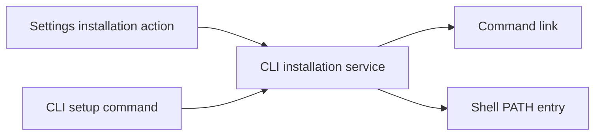

# Installing the Curfew command

Curfew maintainers must keep installation independent of a source checkout. Users install the released app through Homebrew or use Settings → Integrations → Install command line tool after downloading the app. The CLI remains beta.

## Installation behavior

Users run `brew install --cask thehypertextstudio/tap/curfew` and upgrade with
`brew upgrade --cask thehypertextstudio/tap/curfew`. Homebrew verifies the released
DMG's SHA-256 and puts the bundled `curfew-ctl` and `curfew-mcp` executables on
PATH. The [public tap](https://github.com/TheHypertextStudio/homebrew-tap)
distributes the cask. The first tap version selects the October 24, 2026 release
`0.0.16`. The updated CLI ships in the next app release.

The app's installer and `curfew-ctl setup --apply` use the same implementation. `setup` previews by default. Applying creates a symlink in `~/.local/bin` and adds that directory to the selected shell's startup profile only when necessary. The installer supports zsh, bash, and fish. It preserves the existing bash profile precedence and explicit `ZDOTDIR` and `XDG_CONFIG_HOME` locations. It never edits completion settings. A new Terminal loads the updated PATH.

The installer refuses unrelated commands, symlinked or multiply linked profiles, invalid text, and edited Curfew PATH entries. It keeps completed work if interrupted between linking and profile installation. A repeated apply resumes there and leaves a finished installation's bytes and modification times unchanged. An app update at the same path keeps the command link valid. Moving the app requires removing the old link before installing from its new location.

This component diagram shows the shared installation implementation. Both entry points use the same planner and writer.



## Updating the Homebrew release

After the approved app release is public, use these commands from the repository root. The updater verifies the downloaded DMG against the published asset digest before changing the cask. Preview is read-only; repeated apply does not rewrite an unchanged cask.

```bash
node scripts/update-homebrew-cask.mjs --latest
node scripts/update-homebrew-cask.mjs --latest --apply
```

The script resolves one published version, downloads that version's DMG into a disposable directory, verifies its digest, and removes the temporary files. Review and commit a changed cask through the normal pull request process. Run
`node scripts/propose-update.mjs` in the tap repository to open the corresponding
release update. The tap verifies the signed artifact before merging. Use the
accepted release and its published checksum.

## Evidence and rollback

`CLIInstallationTests` covers read-only planning, conflict preservation, interrupted setup, byte- and timestamp-stable repeat installation, linked profile rejection, and native zsh/bash PATH loading twice without duplication. `cask_cli_test.rb` uses Homebrew's native binary installer with disposable command destinations and checks repeat installation and removal. Its optional mounted-app input exercises real released binaries without launching Curfew. The existing uninstall test retains its injected command sink so tests cannot unregister live recovery.

The release digest and signature must be checked separately from source tests. The November 3, 2026 check downloaded `Curfew-v0.0.16.dmg`, verified SHA-256 `4804f7cdf26ec6aa54fc0877d5cc5f7c12043bb972c10502f346f0924a5f8f34`, verified the app's strict signature and embedded CLI's Studio team `T95VDD3A4W`, and validated the stapled notarization ticket. It did not launch or replace the user's installed app.

To reverse direct installation, remove only the `~/.local/bin/curfew-ctl` symlink and the marked Curfew PATH block from the selected profile. Preserve the profile's other contents. Homebrew removes its command links through its native uninstaller. Neither path removes app settings or activity history. Interactive Settings rendering and signed installation of the changed app remain release acceptance requirements until CI and the signed artifact check complete.
