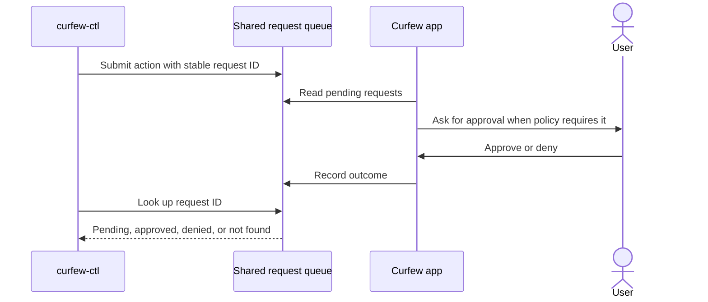

# CLI beta and launch contract

This document is for the Curfew maintainer preparing the CLI for general availability. Use it to implement and verify the command contract before removing the beta label.

The CLI remains beta as of November 3, 2026. The website and user guide must retain that status throughout the launch fixes.

## Required behavior

Read commands must distinguish unavailable state, empty results, and read failures. JSON mode must always produce valid JSON on success, including empty arrays. Failures must use stderr and a nonzero exit code. Unknown live status must remain unknown when the app has no fresh observation.

Budget counts must use the app's persisted runtime grant counters and configured reset weekday. A Wednesday reset must include a grant made the previous Thursday when queried the following Monday. Editing the reset weekday must preserve consumed uses until the new boundary passes. Missing or unreadable runtime authority must never become a full remaining budget.

Schedule inspection must expose saved rules, automatic-schedule consent, hours-based triggers, and pending changes in plain text and JSON. `schedule show` and `schedule` must both work. `schedule set` remains available as beta and submits time-based changes through the existing approval policy and cooldowns. Curfew saves the schedule with a request receipt before acknowledging the queue. If acknowledgement fails, Curfew can recover the original approval without changing the cooldown or superseding a later edit.

Extension requests must use the existing request queue. A request lookup command must expose pending, approved, denied, and missing records without claiming that queue acceptance granted access. Existing protocol shapes remain unchanged.

Override grants require the app's cooldown, reason, and hold confirmation. The legacy CLI command must fail immediately with instructions to use the app. It must not enqueue a request that the app will reject.

Activity must support the documented `--days` option. Reflection exports must validate their date range. Audit reading must expose recorded events without changing them. Protected-work commands need structured output for wrappers that renew and release claims.

Emergency release must preserve current lockout semantics. Revocation must report persistence failures. Dry run must take precedence over every mutation, including revocation. Tests must use temporary stores and injected shutdown cancellation; automated verification must never cancel a real shutdown or alter live enforcement.

## Delivery and verification

Add each regression before its implementation and observe the expected failure. Exercise command parsing, output, exit codes, empty/corrupt stores, custom reset days, disabled schedules, request outcomes, and emergency-release failures. Update the README, website examples, and user guide with actual supported commands.

Run SwiftFormat, strict SwiftLint, package tests, native unit tests, and a Debug build with bounded concurrency. Review rendered website and guide disclosures and CLI help. Installed signed-artifact status parity and emergency recovery need isolated acceptance before general availability.

The app's existing approval boundary is retained because granting overrides through a shell would bypass required confirmation. Adding new wire shapes or weakening approval is rejected. Revisit this decision only with an explicit product change to override policy.

## Open evidence

The beta-disclosure regression failed before the labels were added and then passed with the full 22-test user-documentation suite. Native behavior fixes and installed-artifact acceptance remain incomplete. Source changes do not establish website publication or release readiness.

## Approval sequence

This sequence diagram shows how a CLI request reaches the existing approval policy. Stable request IDs allow a script to repeat submission without adding another request. Result lookup can report a pending decision or a record that was already pruned.

Override requests do not enter this sequence. The CLI directs the user to the app's override confirmation flow.

Protected-work output, concurrency, and emergency recovery are specified in [cli-work-recovery.md](cli-work-recovery.md). Shared package authentication setup and CI behavior are specified in [github-packages-setup.md](github-packages-setup.md).
