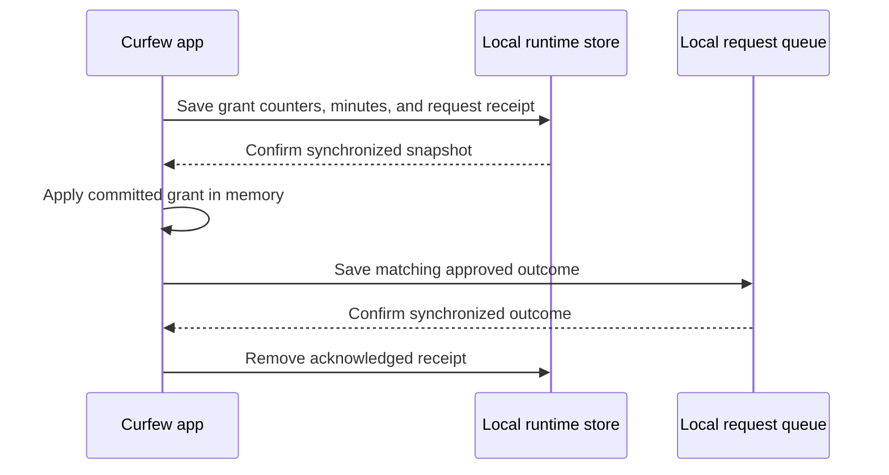

# Recovering extension request acknowledgements

Curfew maintainers must preserve this sequence when changing local extension requests. An app restart must not grant another extension merely because the previous queue acknowledgement failed.

## Commit the grant once

An extension grant writes its consumed count, reset boundary, daily minutes, and unacknowledged request receipt in one atomic runtime snapshot. The receipt contains the UUID, tool name, SHA-256 of the exact argument bytes, and application time. It contains no free-form reason text. Complete files use mode 0600 before publication, and the writer synchronizes both file bytes and the directory rename before returning success.

The app changes its in-memory grant only after that write succeeds. It then persists the approved queue outcome. The queue must contain the same UUID, tool, and argument bytes. An absent entry or conflicting payload cannot acknowledge the grant. The app removes the receipt only after the matching outcome has reached disk.

This sequence diagram shows the two durable records and their acknowledgement boundary.

## Recover without granting again

The app reconciles receipts before applying current consent policy, checking today's eligibility, or showing a new consent sheet. A matching request receives its original approved outcome without another budget use or extension. A conflicting payload under that UUID is never applied. Multiple outstanding receipts remain separate so recovering request A does not discard request B.

Daily rollover and budget edits retain unacknowledged receipts. While its display clock runs, the app retries acknowledgement every 15 seconds. A missing queue entry leaves the receipt intact. Recreating that same request later still recovers the committed result.

A runtime write can report failure after the rename committed. The app therefore leaves that request pending and latches the runtime storage error. It cannot overwrite a possibly committed snapshot with an older in-memory value. A fresh process loads the on-disk result and either recovers its receipt or processes the still-uncommitted request. A failed queue write also leaves the receipt intact. A failed receipt cleanup cannot cause another grant because the approved queue outcome is already durable.

The runtime file remains bounded to 65,536 encoded bytes. A replacement exceeding that bound fails before changing the previous file. The implementation never evicts an unacknowledged receipt to make room for another grant.

## Migrate local history conservatively

Local runtime format 2 adds receipt tracking; this does not change the MCP wire envelope, tool arguments, settings synchronization, or queue statuses. The loader accepts legacy format 1. Before processing requests, the app snapshots the exact pending extension UUIDs already present in the legacy queue and saves them with the migrated runtime. Those requests are denied with an explanation because the old runtime cannot establish whether they already granted time. Requests arriving after the snapshot remain eligible even when their ISO timestamps fall in the same second.

Rollback to a binary that does not understand runtime format 2 is unsupported. Source inspection of release 0.0.16 confirms that it rejects the version and disables local grants through its storage-error path. That is not installed rollback acceptance: older queue handling can still report an outcome that disagrees with a committed grant. Preserve the runtime file and resolve outstanding requests with the receipt-aware version before considering a downgrade. Do not delete grant history to make an older binary run.

## Verification and remaining boundaries

`MCPGrantReceiptTests` covers receipt persistence with counters, multiple outstanding identities, exact-payload conflicts, invalid/legacy preparation, post-commit errors, private file permissions, and oversized replacement preservation. The first regressions observed the previous decoder dropping receipts and the previous writer replacing readable state with an oversized record. `MCPQueueAcknowledgementTests` covers absent entries, conflicting identity preservation, and saved outcomes. Existing request and signer tests cover the shared private publisher's callers.

`MCPGrantRecoveryTests` exercises app restart, changed consent and eligibility, uncertain post-commit failure, the same-process persistence latch, rollover and budget edits, and exact-ID legacy migration. Hosted app tests must run on isolated CI; package tests do not establish app integration acceptance.

Submission deduplication lasts while the queue retains its completed request record. Removing acknowledged queue records also removes that retained identity evidence. A fresh operation must use a fresh UUID. This journal protects accepted extension grants across interruption and acknowledgement failure; it does not claim an unlimited historical idempotency ledger.

## Recover a schedule change

Curfew writes the active schedule, pending change, and request receipt into one
private local file. The schedule editor, automatic application, and incoming sync
all update that same record before showing or enforcing the change. The CLI and
MCP schedule reads use the record when it exists.

After restart, Curfew acknowledges a matching committed request with its original
approval time. It preserves any later edit and the original cooldown. A stale
writer or a reused request ID with different arguments cannot replace the record.
Queue cleanup preserves requests still needed for recovery.

On first launch, Curfew copies the existing schedule and records the IDs of pending
schedule requests from older builds. It denies those requests with instructions
to inspect the schedule before submitting again. A failed durable write leaves the
request pending and prevents more schedule writes until Curfew reopens the file.
The schedule view shows the error. Keep the local record and resolve outstanding
requests before downgrading. Older versions read the preferences mirror and cannot
recover schedule acknowledgements.

`LocalScheduleJournalTests` covers reopen before preferences mirroring, cooldown
preservation, legacy migration, stale writers, and damaged state. The hosted app
regression fails queue acknowledgement, saves a later edit, and restarts before
retrying the original request.
