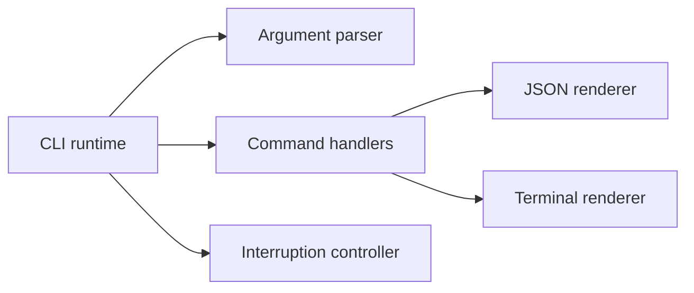

# CLI behavior and installation contract

Curfew maintainers must use this contract when changing `curfew-ctl`. The Studio [CLI standard](https://github.com/TheHypertextStudio/product-standards/blob/main/docs/cli.md) is the owning standard. Keep the beta label until the remaining acceptance below is complete.

## Results and failures

Every command accepts `--json`. Successful output is one object with `schema_version: 1` and `status: "ok"` before the command's fields. Collections have names, including `events`, `reflections`, and `claims`. Approval outcomes use `request_status` so `pending` cannot be mistaken for the transport result. JSON errors contain the same code and message printed on stderr and keep a nonzero process exit status. Redirecting stderr never removes the machine result.

`--verbose` adds operation detail on stderr. `--debug` adds diagnostics and implies verbosity. `--quiet` conflicts with both. `--no-color`, `--no-input`, and `--no-pager` apply on every command. Current commands do not prompt. Terminal headings use color only when permitted by `NO_COLOR`, `FORCE_COLOR`, and `TERM`. `CURFEW_NO_INPUT=1` also disables interactive paging. Parser mistakes return 64. Invalid saved data returns 65. Missing setup or disabled local requests returns 69. Permission failures return 77. Unexpected failures return 70 and save a private support file. `curfew-ctl explain CODE` describes each registered code.

Scalar options cannot be repeated. For example, `activity --days 1 --days 2` fails before a store is opened. `--` still ends option processing. `--name=value` and `--name value` use ArgumentParser's same definition.

## Help, versions, and completion

The executable's help starts with examples and identifies the beta. `help schedule` and `schedule --help` print the same help. The root defaults to `status`. The `work` and `schedule` commands default to `list` and `show`. Schedule editing is available as beta. The `completion` command generates bash, zsh, and fish scripts from the parser. It does not edit shell configuration.

`--version` and `-V` print `curfew-ctl VERSION`. Bundled installations resolve the actual executable through symlinks and read the containing app's `CFBundleShortVersionString`. Source development builds report `0.0.17-beta.1`. A copied development binary is not a released installation. The signed app remains the release-version authority, which prevents the tool and app from claiming different releases after an upgrade.

## Changes and previews

Setup previews by default and writes only with `--apply`. Existing work claims retain their direct command convention; claim and release expose `--dry-run` without creating the claims file or its sidecar lock. Extension requests expose `--dry-run` without signing or queue writes. Emergency recovery retains its own read-only dry run and its tested privilege sequence. Schedule edits remain in the app until their accepted state and acknowledgement can recover together after a crash. Existing approval and shutdown policy remain unchanged.

The JSON envelope replaces the earlier unversioned beta output. Scripts must use named fields and check `schema_version`. Duration fields now use numeric seconds. The conversion retains the app observation's minute granularity and rejects overflowing saved values instead of crashing.

| Earlier beta field         | Schema 1 field             |
| -------------------------- | -------------------------- |
| `minutes_remaining`        | `remaining_seconds`        |
| Activity `minutes`         | Activity `seconds`         |
| Budget `duration_minutes`  | Budget `duration_seconds`  |
| `maximum_deferral_minutes` | `maximum_deferral_seconds` |
| `hours_limit_minutes`      | `hours_limit_seconds`      |

This change adds no cross-device wire shapes and changes no persisted settings or activity formats. Audit records retain their original event payloads.

## Shared command boundary

This component diagram covers the CLI executable. Command handlers retain domain behavior while one runtime applies parser errors and interruption policy. Renderers format completed results without changing settings or enforcement.

## Acceptance

`CLIStandardsTests` covers the versioned envelopes, approval-state separation, JSON failures, repeat-option rejection, spelling suggestions, help parity, app version lookup, completion generation, and read-only work previews. `CLIDurationTests` covers seconds conversion and overflow rejection. `AuditCommandTests` classifies malformed JSON and non-UTF8 retained files as data errors without changing their bytes. `CLIInstallationCommandTests` requires setup to remain discoverable. Request, schedule, work, budget, and recovery suites cover their domain rules with temporary stores and fake shutdown cancellation.

`CLIProcessTests` runs the actual executable through pipes and private pseudo-terminals. The acceptance script checks help and versions, global JSON propagation, matching error codes, native completion syntax and loading, width at 40 columns, `NO_COLOR`, pager selection and bypass, deferred first interruption, immediate second interruption, SIGTERM 143, and quiet SIGPIPE 141. The native run reports which installed shells it checked. Local bash and zsh checks do not establish fish acceptance; CI installs fish and runs the same package test. These tests never open a visible terminal or launch Curfew.

Long activity, reflection, audit, work-list, and help output pages only on an interactive terminal. Pipes, CI, an empty `PAGER`, `--no-pager`, and `--no-input` print directly. The first interruption finishes the current atomic command and returns 130 or 143. A second interruption stops immediately. Completed changes remain in place. Existing app-shared state paths retain the app's canonical macOS locations; implementing independent CLI-only XDG overrides would split the CLI from the app's authority and is rejected. Any coordinated path migration must update every consumer together. Source tests do not establish acceptance of the signed installed release.
