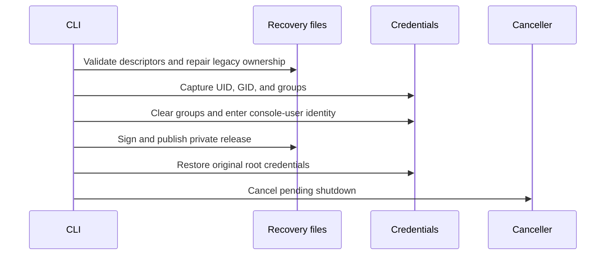
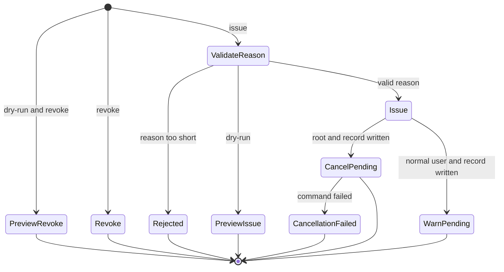

# Protected work and emergency recovery

Curfew CLI maintainers must preserve the behavior below when changing claims or emergency recovery.

## Protected work

The commands use the common [CLI output contract](cli-standards.md). `curfew-ctl work claim --label "build release" --json` includes the stored claim's `id`, `label`, `source`, `started_at`, `expires_at`, and `maximum_deferral_seconds`. Dates use ISO 8601. A 60-minute request receives the policy's 30-minute lease ceiling. Protection still ends at the maximum deferral limit and never unlocks the display.

A wrapper renews with `--id` and keeps that UUID for every retry. Renewal preserves the first start time. `work list --json` includes the data object `{"claims": [...]}` and includes only unexpired claims. `work release UUID --json` includes the data object `{"id": "UUID", "released": true}` after removing the claim. Releasing an absent UUID succeeds again.

Claims must encode to at most 1,048,576 bytes, including every label and JSON escaping. A claim or renewal that exceeds this bound fails before replacing the prior file. Existing claims remain readable and releasable.

CLI reads and claim mutations reject corrupt or unreadable files. They return an error instead of reporting an empty list or overwriting the file. Enforcement still treats unreadable claims as absent. This difference preserves enforcement's existing failure direction.

Claim, release, and clear operations use one sidecar lock for the complete read and write. Each process opens the lock without following a symlink and rejects unsafe entries. Readers can inspect the previous or next atomic snapshot while a mutation runs. The lock file remains after the command exits. Removing it while commands run would let writers take different locks.

## Emergency recovery

Root recovery targets the signed-in console account from `/dev/console` and the system account database. It builds explicit paths under that account's home. Neither `HOME` nor `SUDO_USER` selects the storage target. A root command without a signed-in console account fails before writes. SSH recovery supports a signed-in user whose display is locked; logged-out recovery remains unsupported because the daemon has no trusted persisted user binding.

The CLI validates legacy recovery entries through descriptors anchored at the user-owned home. It repairs root ownership only for the known support-directory components and recovery files. It rejects symlinks, multiply linked files, and other owners. Existing signing bytes remain unchanged. The CLI then clears supplementary groups and drops effective group/user identity for signing, record publication, or revocation. It restores the original credentials before shutdown cancellation. Restoration failure prevents cancellation and returns an error.

This sequence diagram shows the privileged recovery boundary.

An issued release must encode to at most 65,536 bytes, including the reason, issuer, and signature. Oversized releases fail before replacing the prior signed record or cancelling shutdown. These limits match the readers and do not change the wire format. `ProtectionStoreWriteBoundsTests` covers oversized Unicode reasons, escaped renewal labels, and aggregate claim size while verifying prior bytes remain unchanged.

Verification never creates a signing key. Signing creates a key only when none exists. It publishes a complete mode-0600 file with an exclusive rename so concurrent first signers use the same bytes. An unreadable, corrupt, linked, or redirected key produces a failure without rotation. The daemon resolves protection paths on every evaluation so a process started before login can observe the later console user's claims and release.

`break-glass --revoke` needs no issuance reason. Adding `--dry-run` previews removal before the command can change a release. Issuance still requires at least 20 characters of reason. A preview neither creates a signing secret nor invokes shutdown cancellation.

The command signs a real release before root attempts shutdown cancellation. Only a no-match exit reports no pending shutdown. Launch errors, command failures, and signal termination produce a failing CLI exit. The error identifies the saved release and warns that a countdown may still run. The daemon retains pending state and retries a failed cancellation on its next tick. It records the failure instead of claiming cancellation. A shutdown dispatch failure also leaves the daemon eligible to retry at its next policy tick. The daemon reports success and marks a shutdown pending only after dispatch succeeds. Failure records identify `issue_shutdown` or `cancel_pending_shutdown` in their `operation` detail. A normal user receives a warning that the countdown remains active. The display stays locked and the scheduled curfew end remains unchanged. Revocation removes only the release record and never cancels a shutdown. Repeating revocation when the record is absent succeeds. Other removal errors reach the caller and produce a failing CLI exit.

The following state machine shows emergency command dispatch.

## Verification and release impact

`WorkCommandTests`, `ProtectedWorkMutationTests`, and `ProtectedWorkConcurrencyTests` cover output, renewal, expiration, repeated release, read failures, lock rejection, and concurrent claims. `BreakGlassCommandTests` covers issuance, previews, repeated revocation, removal errors, reason validation, and root versus user cancellation. `PendingShutdownCancellerTests` distinguishes successful signals, no matches, command errors, launch errors, and signal termination with an injected runner. `DaemonCancellationFailureTests` verifies failed dispatch and cancellation retries, truthful audit records, and development disarm. `BreakGlassUserStorageTests` covers credential order, errors, restoration, repeat issuance, and previews. `BreakGlassOwnershipRepairTests` covers descriptor validation and preservation. `BreakGlassSignerSafetyTests` covers read-only verification, invalid keys, and parallel provisioning. `DaemonProtectionObserverTests` covers boot-to-login and user-switch path changes. Every ordinary recovery test injects a temporary store and a fake canceller. These tests never invoke `pkill` or modify live enforcement state.

On November 3, 2026, `sudo -n true` required a password on the development workstation, so real privileged ownership acceptance remained unverified locally. `scripts/test-break-glass-ownership.sh` copies package sources into a disposable tree under `build/`. It builds as the ordinary CI user with scratch, cache, configuration, and security paths inside that tree. It runs only `PrivilegedBreakGlassOwnershipAcceptance` there under passwordless sudo. Root never opens the shared checkout's `.build` or package metadata. The fixture uses a fake canceller and exercises legacy root ownership, user readability, repeated issue, and root restoration after an error. The driver removes only its disposable tree afterward. The root fixture stays disabled in ordinary package tests. A skipped fixture does not establish privileged ownership acceptance.

The change adds no wire formats, OS permissions, or entitlements. Existing claims and signed releases remain readable. Corrupt claim writes now fail for all callers, including MCP consumers. Reverting the change restores the previous CLI output and mutation behavior; no data migration is required. The sidecar lock files may remain after rollback. Reverting privileged storage handling can recreate root-owned recovery files and make them unreadable to the app.
