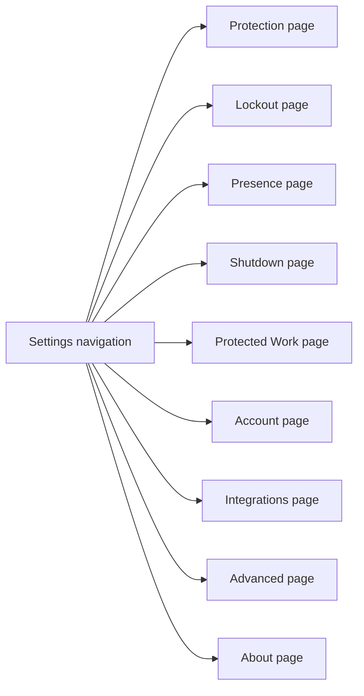

# Settings layout

This note is for maintainers editing Curfew's Settings window. Keep controls in their named category and verify navigation, bindings, feature gates, and compact-window renders before shipping.

## Decision

Settings uses nine categories: Protection, Lockout, Presence, Shutdown, Protected Work, Account, Integrations, Advanced, and About. Each selection displays one page. Protection remains the initial page after the rebase. Existing enforcement and integrations identifiers remain stable.

The previous Enforcement tab placed permission health, extension budgets, warning intervals, camera consent, shutdown, and process lists in one long scroll view. Users had to search unrelated controls to change one setting. A sidebar keeps the categories visible while each page displays only its own controls.

Protection keeps Review Setup or Continue Setup in its fixed page heading. Two minimum-window UI regressions exposed a clipped setup action below helper and permission guidance at 760×520; the action now stays visible while the settings form scrolls. Incomplete setup still has its explanation in the form.

Less common warning controls, process lists, integration setup, and camera data details expand on request. Permission state, camera consent facts, shutdown limits, and the consequences of declared work remain visible. Collapsing the entire previous page would reduce its height but would leave unrelated settings mixed together, so the layout uses separate destinations.

This component diagram shows the Settings navigation and its pages.

## Control refinement

The second October 4 pass uses native switches at the trailing edge and aligns numeric values with their steppers. Extension and override counts share a row with their durations. Short descriptions distinguish delaying scheduled lockout from temporarily unlocking during lockout. The grouped rows fit the normal window without pushing the warning summary below it.

Camera controls and reminder controls occupy separate panels. The camera introduction states the detection limit in two sentences. Privacy facts remain above the switch. Local AI settings state readable data and lockout limits before enabling access, while a disclosure retains the full request and shutdown authority explanation. Disabled reminder values dim with their native controls. Process editors use an inset surface, and Chrome setup has a heading and description when collapsed.

These changes retain native controls instead of introducing custom switch behavior. They preserve all setting bindings, numeric bounds, consent actions, and stored values. Numeric values use locale formatting, and accessible stepper labels distinguish extension and override counts and durations. Existing catalog records remain intact.

## Invariants and validation

The layout retains permission actions, feature and license gates, enrollment state, warning normalization, uninstall confirmation, and upstream account recovery. It changes no stored settings, enforcement decisions, or protocol fields. Protection contains helper setup. Enrolled accounts do not see the stopped legacy iCloud service. Review fixtures retain their intended destination.

The original introduction and local-assistant summary regressions failed before implementation. The October 20 rebase added failing-first coverage for the restored five-minute override wait. After the October 23 rebase, the merged suite passed 998 Swift Testing cases and 96 XCTest cases. All 134 package tests, 187 repository checks, formatting, and strict lint also pass. The rebase retains upstream app identities, setup routing, and the pinned formatter. The unsigned Debug build passes. October 23 live fixture checks reached all nine categories, verified arrow keys and accessible stepper values, and restored a 30-to-35-minute edit to 30. Public help now names the same categories and controls. The test mapping lives in `todo-test-matrix.md`.

Native captures cover all nine categories at 900×680, compact controls at 760×580, expanded details, both appearances, and disabled reminders. Live checks reached all nine pages, changed pages with arrow keys, expanded camera privacy details without enabling capture, and changed the protected-work delay from 30 to 35 minutes before returning it to 30. Accessibility labels exposed names and values. Live selected-row contrast is readable; offscreen AppKit bitmap capture cannot composite native sidebar selection correctly.

Five focused Settings UI tests pass after repairing the generated runner’s invalid resource signature with an ad-hoc signature. Both minimum-window failures were observed before the setup-heading fix and now pass. The full UI suite, spoken VoiceOver, and signed-app permission acceptance remain unverified. Unsigned results do not establish signed distribution behavior. Rollback requires no data migration.
