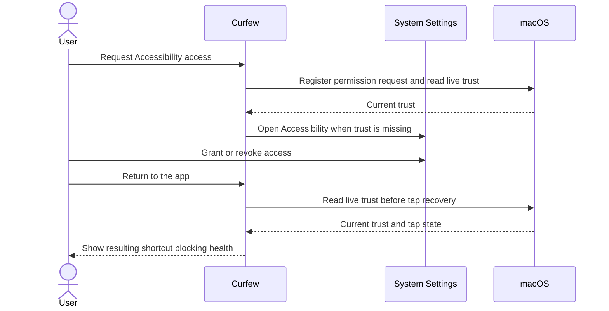

# System permission recovery

This note is for Curfew maintainers changing permission checks or enforcement. Preserve the checks at the action boundary and run the regression tests in `todo-test-matrix.md` before shipping.

## Accessibility

Curfew reads live Accessibility trust before starting or recovering the keyboard tap. It stops interception when trust disappears. The watchdog also checks trust before recovery. macOS remains responsible for authorizing each protected operation; a check in Swift cannot make permission and use atomic.

The explicit repair action registers Curfew through the macOS prompt API and opens Accessibility settings whenever live trust is missing. The API returns current trust and does not report whether macOS displayed a prompt. Counting prior button clicks cannot establish that fact, so Curfew no longer uses a process-wide prompt flag.

The model publishes enforcement health after it attempts tap recovery. App activation and the 1-second enforcement tick refresh trust. The 2-second tap watchdog never requests permission. Tests inject permission state and suppress real taps, dialogs, and Settings windows.

When Accessibility is already trusted, the repair action attempts keyboard shortcut blocking recovery immediately. The missing-permission guidance tells the user to return to Curfew after granting access, rather than requiring a relaunch for every grant.

This sequence diagram shows the permission repair flow between the user and the running applications.

## Calendar

Calendar reads require full access. Write-only access does not permit event reads. Each refresh rechecks permission and clears cached events when access disappears. Stopping the Pro feature also clears cached meetings.

A permission request belongs to the monitoring session that started it. Stopping or restarting the feature invalidates that session, so a delayed reply cannot restart polling or publish meetings. Denied replies never fetch events. Returning from System Settings refreshes an enabled calendar monitor without requesting permission again.

## Release checks and rollback

These changes add no entitlements, wire formats, or stored settings. Calendar remains behind its existing feature and license gates. Reverting the change requires no data migration, but restores the stale-permission defects.

On October 4, 2026, the local signing check selected an ad-hoc identity, and Xcode rejected the explicitly selected development certificate. A second identity attempt also failed because the app lacked a suitable App Groups provisioning profile. An enabled Curfew row in Accessibility settings is not proof that the current executable is trusted. For example, replacing an ad-hoc build changes its code identity and can invalidate its grant. Keep the existing signed-build guard. Verify grant, revoke, and regrant with the signed build that will ship; an unsigned test run cannot establish TCC behavior for that build.

Automated tests cover permission changes through injected adapters. They do not prove live TCC dialogs, keyboard interception, or certificate validity.

The full unit run also exposed an incomplete fixture in the Docket refresh test. That fixture now contains an expired access token, its expiration, and the refresh token required by `DocketCredentialStore`. The test still checks rotation of both credentials; production OAuth behavior did not change.
